<div align="center">



<br>


**A friendly, customer-facing engineer for your AI agent.**
It listens first, maps the customer's world, then ships a working integration or prototype fast.

[Install](#-install) · [How it works](#-how-it-works) · [Commands](#-commands) · [Example](#-example) · [Safety rules](#-safety-rules)

</div>

---

## 🧭 What is this?

A **Forward Deployed Engineer (FDE)** sits with the customer, listens to their idea, and puts a real working demo in front of them, fast.

This repo turns your AI agent into one. **No coding knowledge needed:** the customer describes the app in everyday words, and the agent builds it, tests it and hands over a demo script, all within one day.

> Built for demo day: the agent agrees one clear **Golden path** with the customer, then makes sure that exact flow **never breaks**. It rehearses it 3 times from a reset, removes dead ends, fails softly, and never depends on a live service it hasn't tested.

## ⚙️ The whole process: 3 steps



| Step | What happens |
|---|---|
| **1. Ask** | One message with up to 5 plain questions (each with a default). Then a **Demo contract**: what the app does, the **Golden path** (the exact click-by-click flow), and 3 to 5 checks that mean "yes, it works". |
| **2. Build** | The smallest app that meets the contract, with realistic sample data, a one-command start and a one-command reset. Nothing extra. |
| **3. Prove** | Rehearse the Golden path 3 times from a reset. No dead ends, friendly errors instead of crashes, live services mocked or tested offline. Then freeze. |

You then get a 5-minute demo script, a fallback plan and a plain-words summary.

### The one command to remember

```text
/fde-build  a booking app for my salon where customers pick a time slot
```

In agents without slash commands, type `build: <your idea>`.

## ✨ Why use it

| A typical agent | The Forward Deployed Engineer |
|---|---|
| Starts coding right away | Agrees a Demo contract first |
| Builds the whole thing | Ships the thinnest working slice |
| Hardcodes keys and URLs | Secrets in env vars, config in one place |
| Says "done" | Says what was **rehearsed, what is mocked, and what is next** |
| Prototype looks like production | Labels every build: Prototype, Pilot or Production |

## 📦 Install

<details open>
<summary><b>Any agent (simplest)</b></summary>

<br>

Copy [`AGENTS.md`](AGENTS.md) into your project root. Done.

| Tool | Where to put it |
|---|---|
| Codex, OpenCode and most agents | `AGENTS.md` in the project root |
| Claude Code | save as `CLAUDE.md` in the project root |
| Cursor | `.cursor/rules/forward-deployed-engineer.mdc` |
| Windsurf | `.windsurf/rules/forward-deployed-engineer.md` |
| Cline | `.clinerules/forward-deployed-engineer.md` |
| GitHub Copilot | `.github/copilot-instructions.md` |

</details>

<details>
<summary><b>Claude Code plugin</b></summary>

<br>

Run these as two separate prompts:

```
/plugin marketplace add 3ldho98/fde-agent
```

```
/plugin install forward-deployed-engineer@fde-agent
```

</details>

## 🕹️ Commands

| Command | Plain-text trigger | What it does |
|---|---|---|
| `/fde-build` | `build: <idea>` | The full process: ask, contract, build, prove, demo script |
| `/fde-check` | `check:` | Rehearses the Golden path 3 times and reports PASS/FAIL |
| `/fde-scope` | `scope: <problem>` | Only the questions and the Demo contract, no code yet |
| `/fde-demo` | `demo:` | Writes or refreshes the demo script |
| `/fde-handoff` | `handoff:` | Short README: how to run it, gaps, next steps |
| `/fde-risks` | `risks:` | What could break and how to check each item |

The slash commands work in Claude Code. In any other agent, type the plain-text trigger.

## 💬 Example

```text
Customer: build: a booking app for my salon where customers pick a time slot

FDE:      Happy to! Five quick questions (reply "yes" to accept my guesses):
          1. Goal: let customers book a slot without calling you?   [yes]
          2. Users: customers on phones, you on a laptop?           [yes]
          3. Must-do in the demo: pick a service, a time, see confirmation. [yes]
          4. Existing data: none, I'll use sample services/stylists. [yes]
          5. Success: a booking shows up in your list instantly.    [yes]

Customer: yes to all

FDE:      Demo contract agreed. It is done when:
          Golden path: open app > pick "Haircut" > pick tomorrow 3pm > enter name > see confirmation > open the bookings page
          - A customer can book a haircut for tomorrow at 3pm in under 30 seconds
          - Two people can't book the same slot
          - You can see all bookings on one page
          Building now...

          You can now:       open the app and book a slot
          How to run it:     python app.py
          I rehearsed:       Golden path 3 out of 3 passes
          To reset the demo: python reset.py
          Not included yet:  payments, reminders (listed under "Later")
          I need from you:   your real service list when you're ready
```

## 🛡️ Safety rules

The agent follows these on every integration:

- 🔐 Secrets live in environment variables. Never hardcoded, committed or printed.
- ✅ Everything that crosses a system boundary is validated.
- ⏱️ Network calls get timeouts, retries with backoff and clear errors.
- 🔁 Writes are idempotent when possible.
- 🧪 Dry-run or sandbox by default. No real emails, messages or payments without confirmation.
- 🙈 No sensitive customer data in logs.

## 🏷️ Prototype, Pilot, Production

| Level | Meaning |
|---|---|
| 🧪 **Prototype** | Proves the idea. Happy path, shortcuts allowed (marked `shortcut:`). |
| 🚦 **Pilot** | Real users. Basic tests, logging and error handling. |
| 🏭 **Production** | Monitoring, tests, security review and docs. |

## 🤝 Contributing

Ideas and improvements are welcome. Open an issue or a pull request.

## 📄 License

MIT. Use it, change it, share it.

<div align="center">

Made by [@3ldho98](https://github.com/3ldho98)

</div>
